# School Management System

[](https://github.com/yael-72/school-management-system-aspnet-angular/actions/workflows/ci.yml)

A full-stack admin system for a school, built with **ASP.NET Core 10** and **Angular 22**.
The principal and the teachers log in to manage classes, students, attendance, exams and grades,
and get a dashboard that summarizes the school. The interface is in Hebrew (right-to-left), with a
dark mode, and follows the [Horizon UI](https://horizon-ui.com/) design.

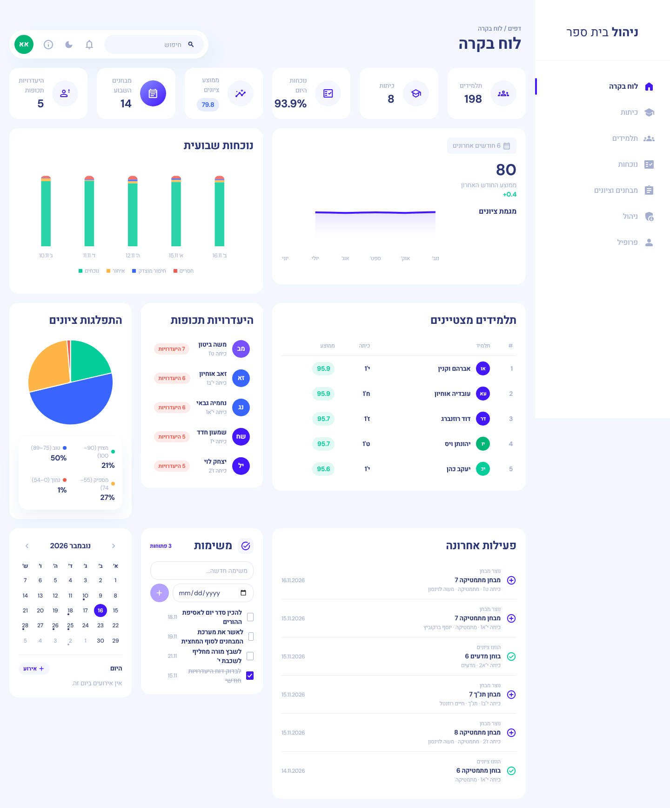

## Contents

- [Features](#features)
- [Screenshots](#screenshots)
- [Run it](#run-it)
- [Tech stack](#tech-stack)
- [Architecture](#architecture)
- [Technical decisions](#technical-decisions)
- [Tests](#tests)
- [API](#api)

## Features

- **Role-based access.** The admin sees the whole school. A teacher sees only the classes she teaches in
  or is the homeroom teacher of, and can grade only the subjects she teaches there. The rule is enforced
  on the server (403), and the UI hides what the user cannot do.
- **Dashboard.** KPI cards, a monthly grades trend, weekly attendance, a grade distribution, top students,
  students with frequent absences, recent activity, a personal to-do list and a school calendar.
- **Classes and students.** Card grid with grade tabs, a searchable, sortable and paged students table,
  and a student page with average, attendance rate and latest scores. Students are soft-deleted, so their
  history is kept.
- **Attendance.** A daily register for a class (present / absent / late / excused, with notes and
  "mark the rest present"), saved in one request, plus a report for any date range.
- **Exams and grades.** Exams, quizzes and assignments per class and subject, and a grade sheet with
  live, color-coded percentages and statistics.
- **Profile.** Personal details, password change, private file uploads with a storage quota, and
  notification settings.
- **Administration (admin only).** Staff accounts (add with a first password, edit, reset the password,
  deactivate, delete),
  subjects, and teacher assignments – the rows that decide which classes each teacher can see and grade.
  Guard rails: an admin cannot lock herself out, and a user or subject with school history cannot be
  deleted (users are deactivated instead).
- **Quality of life.** Hebrew RTL layout, dark mode, responsive down to phone width, loading skeletons,
  empty states and friendly Hebrew error messages on every data view.

## Screenshots

| | |
|---|---|
| 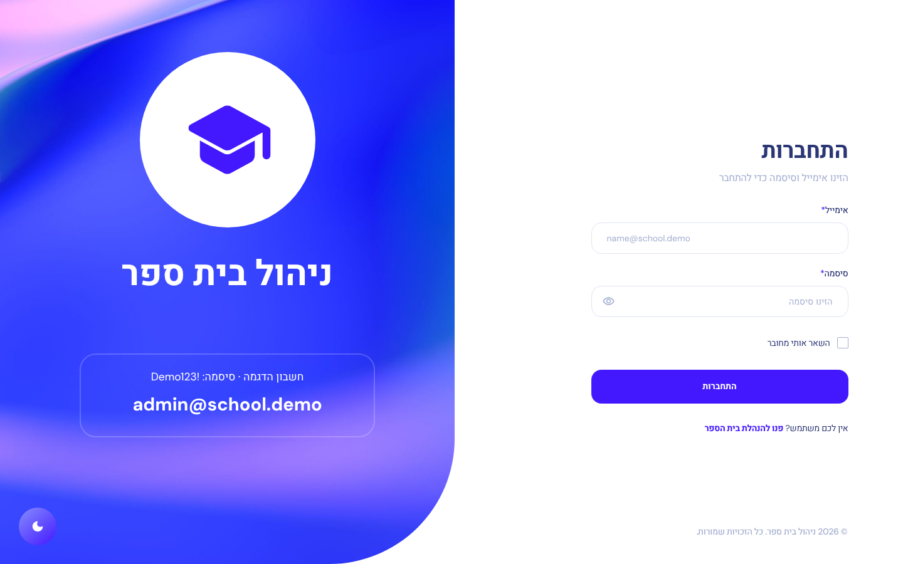 | 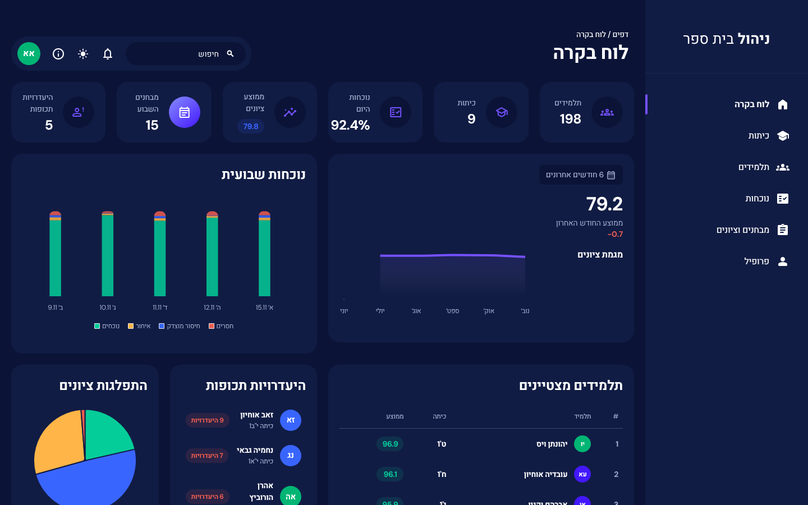 |
| **Sign in** | **Dashboard, dark mode** |
| 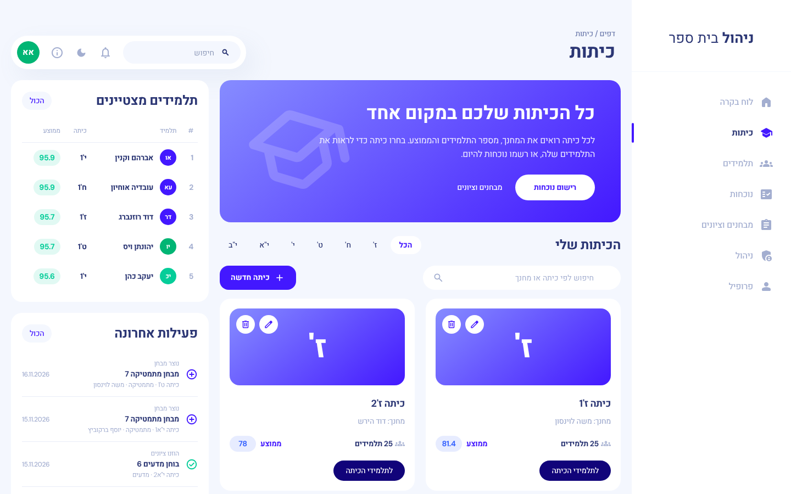 | 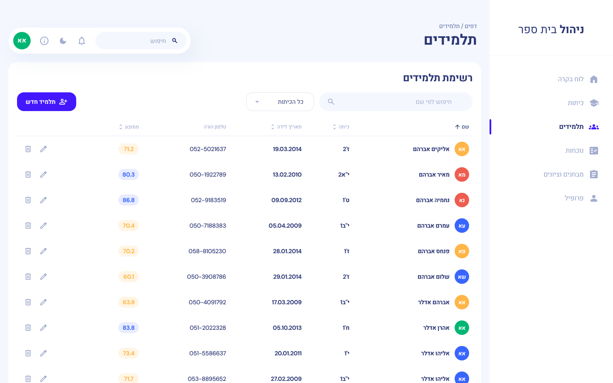 |
| **Classes** – card grid, grade tabs, side panel | **Students** – search, sort, paging |
| 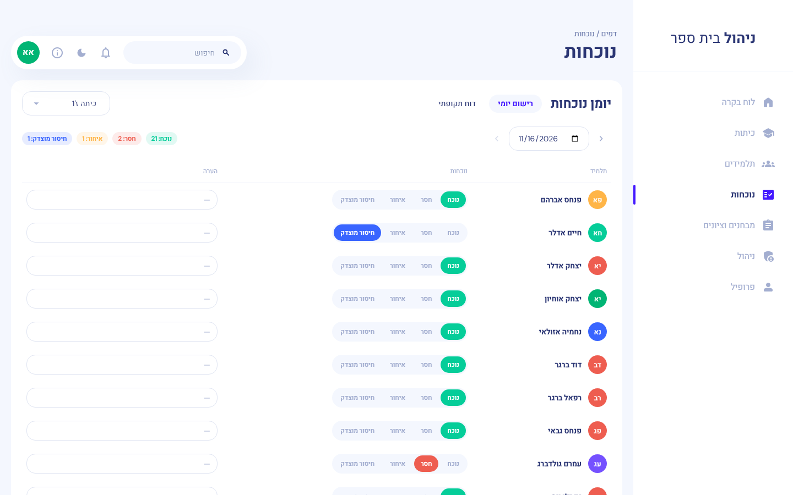 | 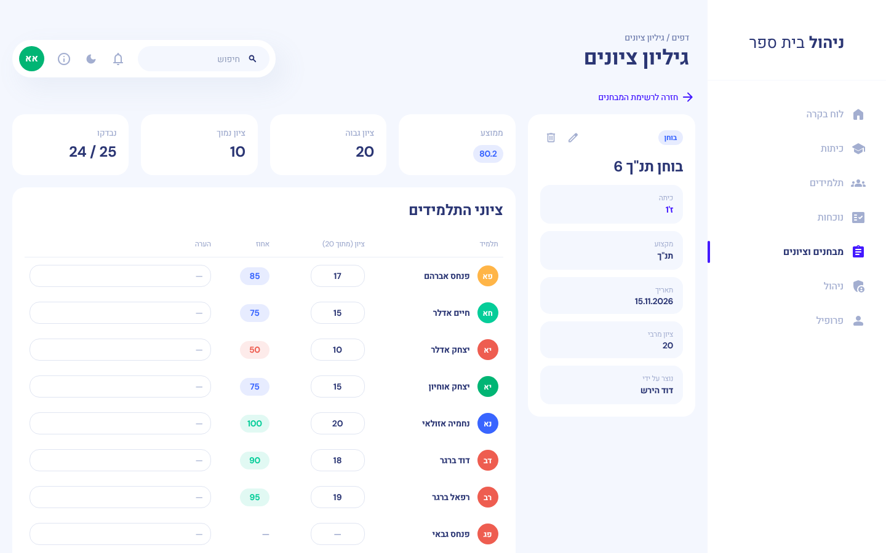 |
| **Attendance register** | **Grade sheet** – color-coded scores |
| 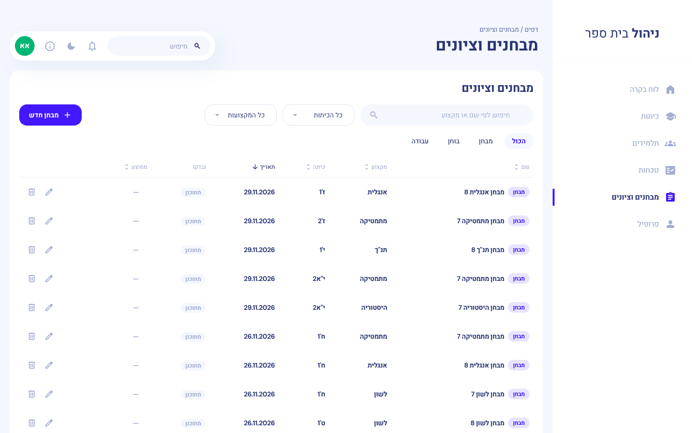 | 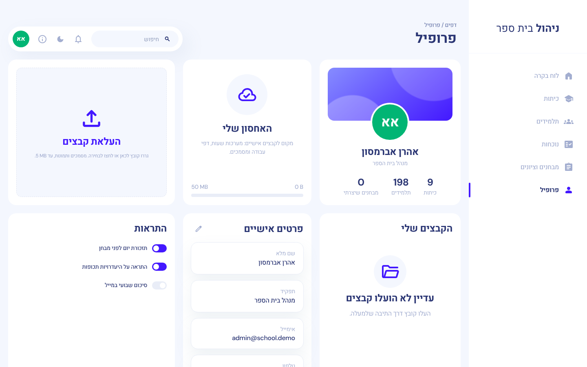 |
| **Assessments** | **Profile** – files, storage, notifications |
| 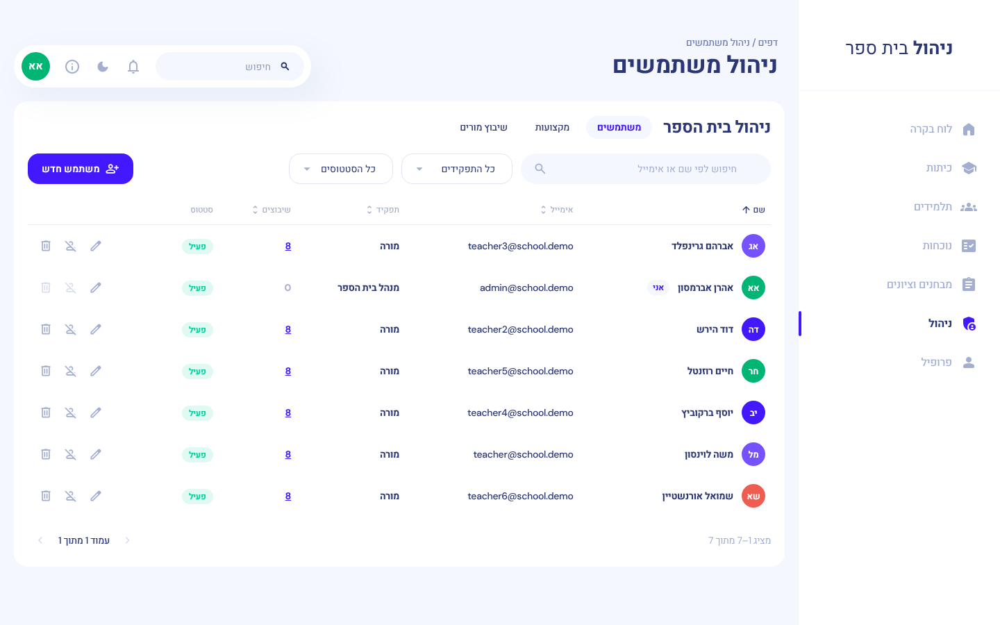 | |
| **Administration** – staff, subjects, teacher assignments | |

<p>
  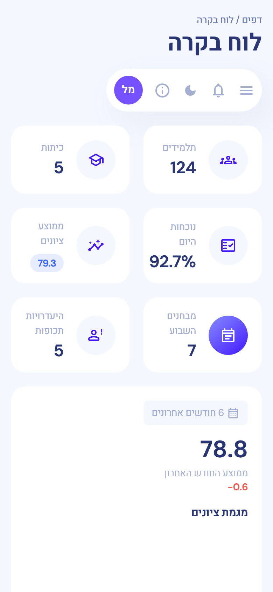
  &nbsp;
  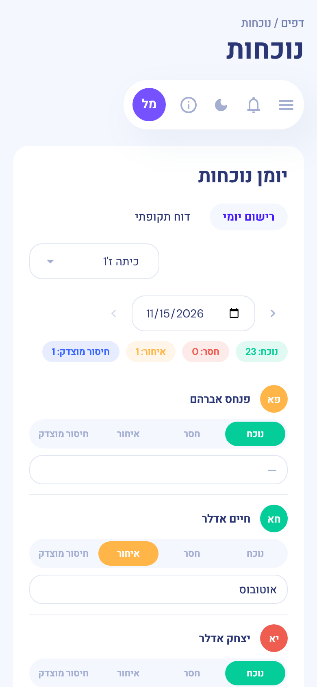
</p>

All screenshots are taken from the app running with Docker Compose and its demo data.

## Run it

### With Docker (recommended)

You only need [Docker](https://docs.docker.com/get-docker/).

```bash
cp .env.example .env
docker compose up --build
```

Open **http://localhost:8080**. The first start creates the database and fills it with demo data
(about a minute). The API documentation (Swagger) is at http://localhost:8080/swagger.

### Demo accounts

| Role | Email | Password |
|---|---|---|
| Principal (admin) | `admin@school.demo` | `Demo123!` |
| Teacher | `teacher@school.demo` | `Demo123!` |

Other teachers: `teacher2@school.demo` … `teacher6@school.demo`, same password. Log in as the teacher and as
the admin to see how the same screens show different data.

### Live demo on Azure

The live demo runs on Azure's free tiers (App Service F1 + Azure SQL free offer) and is deployed by
GitHub Actions after every push to `main`. One App Service serves both the API and the Angular site.
In the live demo the demo accounts cannot be locked out (no password, role or status changes) and the
data is reset every time the app starts. Setup and limits: [docs/deployment.md](docs/deployment.md).

### For development

Requirements: .NET 10 SDK, Node.js 24 (or 22.22+), and SQL Server (LocalDB on Windows, or the
`db` service from `docker-compose.yml`).

```bash
cd backend
dotnet run --project src/SchoolManagement.Api
```

The API listens on http://localhost:5097. In Development it applies the migrations, adds the demo data and
generates a temporary JWT signing key. To use another database, set the connection string with
user-secrets:

```bash
dotnet user-secrets set "ConnectionStrings:DefaultConnection" "Server=localhost;Database=SchoolManagementDev;User Id=sa;Password=...;TrustServerCertificate=True" --project src/SchoolManagement.Api
```

```bash
cd frontend
npm install
npm start
```

The app runs on http://localhost:4200 and forwards `/api` to the API (`proxy.conf.json`).

## Tech stack

| Layer | Technology |
|---|---|
| Backend | ASP.NET Core 10 Web API, C# |
| Data | Entity Framework Core 10 (code-first, migrations), SQL Server 2022 |
| Auth | JWT bearer tokens, PBKDF2 password hashing |
| Frontend | Angular 22 – standalone components, signals, `rxResource`, reactive forms |
| Charts | ApexCharts (ng-apexcharts) |
| Styling | SCSS with CSS variables (design tokens), logical properties for RTL |
| Tests | xUnit + FluentAssertions, `WebApplicationFactory`; Vitest for Angular |
| DevOps | Docker, Docker Compose, nginx, GitHub Actions |

## Architecture

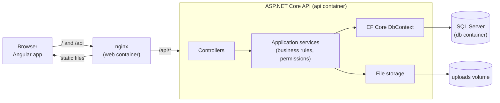

The backend follows a simple **Clean Architecture** split into four projects:

| Project | Contains | Depends on |
|---|---|---|
| `SchoolManagement.Domain` | Entities, enums, the school calendar rule | – |
| `SchoolManagement.Application` | Services with the business rules, DTOs, validation, interfaces (`IApplicationDbContext`, `IFileStorage`, …) | Domain |
| `SchoolManagement.Infrastructure` | `AppDbContext`, EF configurations, migrations, seed data, JWT, password hashing, local file storage | Application |
| `SchoolManagement.Api` | Controllers, exception handler, auth and Swagger setup | Application, Infrastructure |

A request goes **controller → application service → DbContext**. Controllers only translate HTTP
to service calls; every rule lives in a service, where it is unit-tested.

The Angular app is split into `core` (auth, interceptors, guards, API helpers), `layout` (sidebar,
navbar), `shared` (reusable components such as stat card, dialog, paginator, score badge, toggle) and one
lazy-loaded folder per feature.

## Technical decisions

- **Permissions come from the data, not only from the role.** Being a teacher does not give access to a
  class; a row in `TeacherAssignments` (or being the homeroom teacher) does. One service,
  `IClassAccessService`, answers "may this user see / grade this class?", and every feature uses it,
  so the rule lives in one place. Lists are filtered in SQL with a sub-query; single items return
  404 before 403.
- **No generic repository.** EF Core's `DbContext` already is a unit of work with repositories (`DbSet`).
  Services use it through a small `IApplicationDbContext` interface, which keeps the Application layer
  free of Infrastructure and lets tests use an in-memory database.
- **Read queries project to DTOs in SQL.** List endpoints use `AsNoTracking` and `Select` into DTOs,
  so only the needed columns are read and aggregates (averages, counts) are computed by SQL Server.
  Entities never leave the API.
- **Errors are ProblemDetails.** Services throw `NotFoundException`, `ForbiddenException` or
  `BusinessRuleException`; one global handler turns them into RFC 7807 responses (404 / 403 / 400). The API
  writes messages in English, and the Angular app translates them into Hebrew for the user.
- **Attendance uses a status picker, not a checkbox.** A checkbox can only say present or absent; a school
  also needs "late" and "excused", which count differently in the attendance rate. Each row has four
  status pills (real radio buttons, so the keyboard and screen readers work), plus "mark the rest present".
- **Upserts for bulk screens.** Attendance and grades are saved in one request for the whole class.
  The service updates the rows that exist and adds the missing ones; unique indexes on
  (student, date) and (assessment, student) guard against duplicates.
- **Secure by default.** Every endpoint needs a logged-in user unless it says otherwise. Passwords are
  hashed with PBKDF2; changing your own password needs the current one, and a wrong current password is a
  400 (not a 401), so the app shows a message instead of logging the user out. Uploaded files get a server-generated name, are checked for size, type and quota,
  are private to their owner, and are always downloaded as attachments. No secrets are stored in the
  repository: the JWT key and database password come from user-secrets or environment variables.
- **Signals and `rxResource` in Angular.** Every page describes its data as a resource driven by
  signals (page, sort, filters), so loading, error and reload states come for free and stay consistent.
  Forms are reactive forms with validation messages.
- **Design tokens.** Colors, radii and shadows from the Horizon UI Figma file are CSS variables. Dark mode
  only redefines the variables, and the charts read the same variables, so they follow the theme too.
  All layout uses logical properties (`margin-inline-start`, …), which makes RTL work without
  separate styles.
- **A demo mode for the public site** (`Demo:Enabled`, off by default). Everyone shares the same demo
  accounts, so in demo mode they cannot get a new password, be deactivated or change role, and each start
  of the app clears the data and seeds a fresh school (undoing visitors' changes and keeping the dates
  current). It is one setting and one small guard class, not a separate code path.
- **Demo data is generated at runtime**, not in a migration, because thousands of score and attendance
  rows have dates relative to "today". A fixed random seed makes every run produce the same school.

## Tests

| Suite | Count | What it covers |
|---|---|---|
| Backend unit tests | 135 | Business rules per service: permissions, score limits, attendance rules, upserts, dashboard numbers, file rules, user / subject / assignment management |
| Backend integration tests | 81 | The real API in memory (`WebApplicationFactory`): routing, auth, validation, status codes, JSON, error handling |
| Frontend tests | 98 | Services, guards, interceptors, error messages and the components with logic (attendance register, grade sheet, to-do list, upload, toggles, user form, password dialogs, subjects, sidebar per role) |

```bash
cd backend && dotnet test
cd frontend && npx ng test --watch=false
```

GitHub Actions runs all of them, plus a build of both Docker images, on every push. A second workflow
(`deploy.yml`) runs the backend tests again and deploys `main` to Azure.

## API

All endpoints are under `/api`, return JSON, and use ProblemDetails for errors. List endpoints accept
`page`, `pageSize`, `search`, `sortBy` and `sortDir` and return `{ items, totalCount, page, pageSize }`.
The full, interactive list is in Swagger.

| Area | Endpoints |
|---|---|
| Auth | `POST /auth/login`, `GET /auth/me` |
| Classes | `GET/POST /classes`, `GET/PUT/DELETE /classes/{id}`, `GET /classes/{id}/students` |
| Students | `GET/POST /students`, `GET/PUT/DELETE /students/{id}`, `GET /students/{id}/summary` |
| Attendance | `GET /attendance?classId=&date=`, `PUT /attendance`, `GET /attendance/report` |
| Assessments | `GET/POST /assessments`, `GET/PUT/DELETE /assessments/{id}`, `GET/PUT /assessments/{id}/scores` |
| Dashboard | `GET /dashboard/stats`, `grades-trend`, `attendance-weekly`, `grade-distribution`, `top-students`, `recent-activity` |
| Calendar and tasks | `GET/POST /events`, `PUT/DELETE /events/{id}`, `GET/POST /tasks`, `PUT/DELETE /tasks/{id}`, `PATCH /tasks/{id}/toggle` |
| Profile and files | `GET/PUT /users/me`, `PUT /users/me/password`, `GET/PUT /users/me/notification-settings`, `GET/POST /files`, `GET /files/{id}/download`, `DELETE /files/{id}` |
| Administration (admin) | `GET/POST /users`, `GET/PUT/DELETE /users/{id}`, `PATCH /users/{id}/status`, `PUT /users/{id}/password`, `GET /roles`, `POST /subjects`, `PUT/DELETE /subjects/{id}`, `GET/POST /teacher-assignments`, `DELETE /teacher-assignments/{id}` |
| Reference data | `GET /subjects` (any user) |

`backend/src/SchoolManagement.Api/SchoolManagement.Api.http` has ready-to-run sample requests.

---

Built by **Yael Turk** as a portfolio project. The UI is based on the free
[Horizon UI](https://horizon-ui.com/) design by Simmmple; avatars use initials instead of photos.
